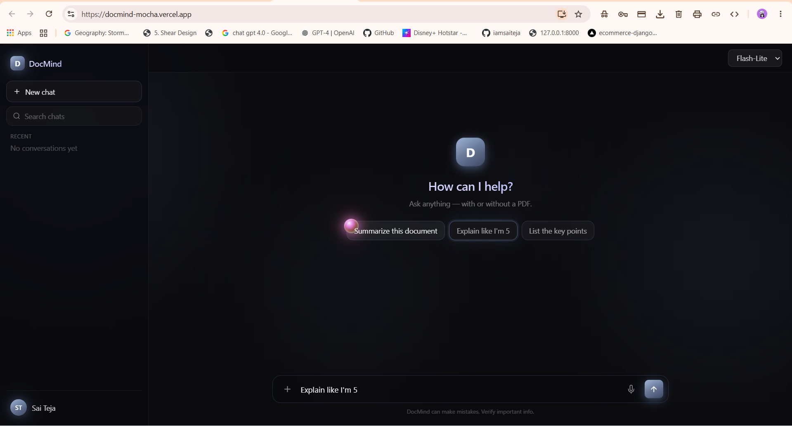

# DocMind — session-isolated PDF assistant
Upload PDFs, ask questions and receive streamed answers with document/page sources. FastAPI, React, ChromaDB and Gemini. [Existing demo](https://docmind-mocha.vercel.app) · [Repository](https://github.com/iamsaiteja/docmind-ai-rag)



## Local setup (Python 3.12, Node 22)
Backend:
```sh
cd backend
python -m venv .venv
source .venv/bin/activate
pip install -r requirements.txt
cp .env.example .env
# Fill GEMINI_API_KEY; generate SESSION_SECRET with:
python -c 'import secrets; print(secrets.token_urlsafe(48))'
uvicorn main:app --reload
```
On Windows activate `.venv\Scripts\activate` and copy `.env.example` to `.env` using your file manager. Backend: http://localhost:8000, docs: http://localhost:8000/docs.

In another terminal:
```sh
cd frontend
npm ci
npm start
```
Frontend: http://localhost:3000. Set REACT_APP_API_URL to the backend base URL for deployments; otherwise it uses http://localhost:8000. Backend CORS_ORIGINS must list the frontend origins. Configure a persistent random SESSION_SECRET before using document endpoints, and keep it identical across workers.

## Privacy and behavior
- POST `/sessions` issues an unguessable signed bearer token valid for 24 hours. The frontend stores it locally. Each upload/query is scoped to that session. This is anonymous browser-session isolation, not account authentication; anyone holding the token can access that session. Chats in the same browser session share uploaded documents.
- Old unscoped document collections are never queried. Remove old `documents` data administratively after checking retention needs; this change does not delete existing stored user data automatically.
- PDFs are read in memory, never written using a supplied filename. Limits: five files/request, 10 MiB/file, 100 pages/file, 1,000 chunks/file and 5,000 chunks/session. No OCR or encrypted PDFs.
- Expired document chunks are removed lazily when indexing/querying resumes. An idle server may retain expired data on disk until the next operation. Restart/secret rotation invalidates tokens if the secret changes; upload again after expiry.
- Replies are instructed to use document excerpts and abstain when evidence is missing. This reduces unsupported answers, but does not guarantee an LLM can never hallucinate. Empty sessions do not invoke the LLM; retrieval errors return an explicit error.
- Chat titles are derived locally by the backend from the question, not claimed to be AI-generated. No paid title-generation call.
- API/provider error details are logged server-side rather than returned to users.

## API
| Method | Endpoint | Authorization |
|---|---|---|
| GET | `/` | None |
| POST | `/sessions` | None |
| POST | `/upload-pdf` | Bearer session token; multipart `files` |
| POST | `/ask` | Bearer token; question/model/history JSON |
| POST | `/ask-stream` | Same; SSE sources/delta/done/error |
| POST | `/generate-title` | Bearer token; question JSON |

## Validation
Backend: `pip install pytest httpx` then `python -m pytest -q` from backend/. Tests fake provider/vector storage and cover session isolation, invalid/expired tokens, unsafe filenames, bad/oversized uploads and retrieval failures. Frontend: `CI=true npm test -- --watchAll=false` and `npm run build`. GitHub Actions runs these checks.

## Deployment limits
This remains a portfolio demo. Place provider quotas, request/body limits and rate limiting at the hosting gateway before exposing paid API operations broadly. Session issuance is public, so per-session upload caps alone do not prevent abusive new sessions. The quota read/add is not a distributed transaction; concurrent uploads can overshoot a session cap. Single-host Chroma persistence needs durable storage and backups. No account recovery, OCR, automated model evaluation or guaranteed answer accuracy is claimed. Test the deployed upload/query flow with a non-sensitive sample PDF after configuring Gemini; unit tests do not call paid services.

Author: Sai Teja Golla · [GitHub](https://github.com/iamsaiteja) · [LinkedIn](https://www.linkedin.com/in/golla-saiteja)
